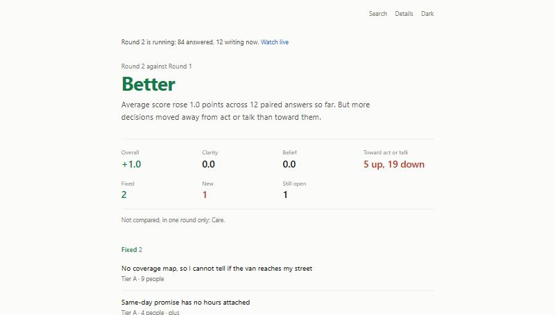

# LLM Council

A Claude skill that puts any idea, offer, plan, draft, price or decision in front of a council of independent simulated people, lets you watch them think in a live browser view, and ranks the problems they share into a short action list.

Ask one model and you get one careful, agreeable voice. A council gets real spread: each seat is a separate process with its own life and temperament, reading only the real materials and never another seat's answer.



## The six natures

| Nature | How it judges everything |
|---|---|
| 🗡️ Contrarian | Hunts the fatal flaw. Never says it's fine. |
| 🌟 Believer | Shows how it pays off and where it could be bigger. |
| ⚖️ Neutral | Weighs pros and cons. The only nature that gives scores. |
| ❓ Confused | Asks everything a newcomer would not understand. |
| 🔬 First Principles | Asks what is really being solved, and whether this is the right question. |
| 🛠️ Executor | Walks through Monday morning and names each stall. |

Use the natures alone for a plan or decision (6 seats). Cross them with personas when the answer depends on who is judging: 12 personas make 72 people, each with their own first-person interview.

The strongest signals come from seats going against type: a blocker from the Believer, and what still held up for the Contrarian. Keep the seats fixed and change the draft, and you can compare drafts person by person.

## Live viewer

```text
node skills/llm-council/viewer/serve.mjs --demo
```

Node 18 or later, nothing to install. It runs on your machine only, and `--demo` streams invented answers so you can try it.

Point it at a folder of rounds and the first screen answers one question: **is this improving?** The latest round against the one before it, as a verdict in words (better, worse, no real change), changes in overall score, clarity and belief, decisions moved toward act or talk, and one ranked list of problems fixed, new and still open. Click a problem to read the people who raised it.

Only the same person on the same LLM, with the same prompt and persona, is compared. LLMs in only one round are left out and named. If the recorded fingerprints differ, it says findings only. Better or worse needs a move of at least half a point that the spread of the answers cannot explain.

Everything else sits under **Details**:

| Section | What it answers |
|---|---|
| Live | What is each seat writing right now? |
| Room | Who is in the council, by persona and nature? |
| Ideas | What better framings, first steps and questions came up? |
| Scores | How did Neutral seats decide on each option? |
| LLMs | Where do LLMs disagree on the same person? |
| All findings | Everything raised, grouped by wording |
| Rounds | Every round, and any two compared in full |

Keys: `/` search, `d` details, `j` and `k` move through the list, `Esc` goes back. Pointing at one run folder still works.

`--static <file.html>` writes one page you can share. It holds every answer, so keep it private unless your materials are public.

Before a round is ranked, problems are grouped by shared words, so similar wording can stay split until the final ranking merges it. Fixed means seats stopped raising something, matched by wording, so check before trusting it.

## Install

As a Claude Code plugin:

```text
/plugin marketplace add seifsg/llm-council
/plugin install llm-council@llm-council
```

Or copy `skills/llm-council` into your personal or project skills folder. Real runs need a host that can start separate agent processes.

## Use

Just ask:

```text
Run a council on this pricing page before I publish it.
Red-team my plan to move off the old billing system.
Get me a panel of buyers on these three landing page headlines.
```

The skill asks what decision the result will change, confirms what seats may read, shows you the people and a cost estimate from a small pilot, and only then runs the rest. Each run lives in `.council/<run-name>/`. Add `.council/` to your `.gitignore`.

## Safety

The seat prompt tells each simulated person they are real and unrestrained, including a blunt uncensored block. That is safe only because the runner holds the limits: a separate process, an empty folder, no access to your files, and web lookups as its only tool. Never give that prompt to an agent with file, shell or send tools. The skill says to cut the block when isolation is not possible. Model providers' own rules still apply.

## What it cannot do

These are simulated people. They find confusion, objections and blind spots, but they cannot show that anyone would really pay, use or agree. The skill records real reactions alongside each finding, and real ones always win.

## License

[MIT](LICENSE)
